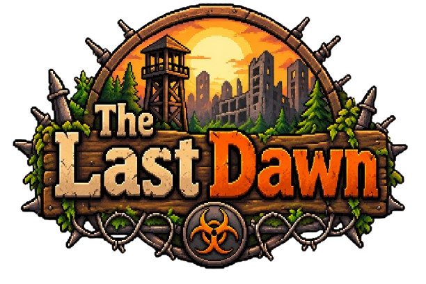

# The Last Dawn

Jeu de survie zombie en pixel art, vu de dessus : récolte, fouille des épaves, bâtis ton camp le jour et tiens jusqu'à l'aube face aux
vagues de zombies. Toutes les 7 nuits vient la **Nuit rouge** et son boss… puis tout recommence, en plus dur. 3 classes : Assault, Tank,
Médecin. Développé par **SnkAlex** (version alpha, réservée aux testeurs).

## Télécharger
Va dans **[Releases](https://github.com/SnkStudio/TheLastDawn/releases/latest)** et télécharge `Installer.The.Last.Dawn.x.y.exe`.

- Windows peut afficher « Windows a protégé votre ordinateur » : clique sur **Informations complémentaires** puis **Exécuter quand même**.

## Mises à jour
Le jeu vérifie tout seul au lancement s'il existe une nouvelle version : clique sur **Installer la mise à jour** sur l'écran titre.
Tes sauvegardes ne sont jamais touchées.

Ce dépôt contient seulement les versions du jeu.
